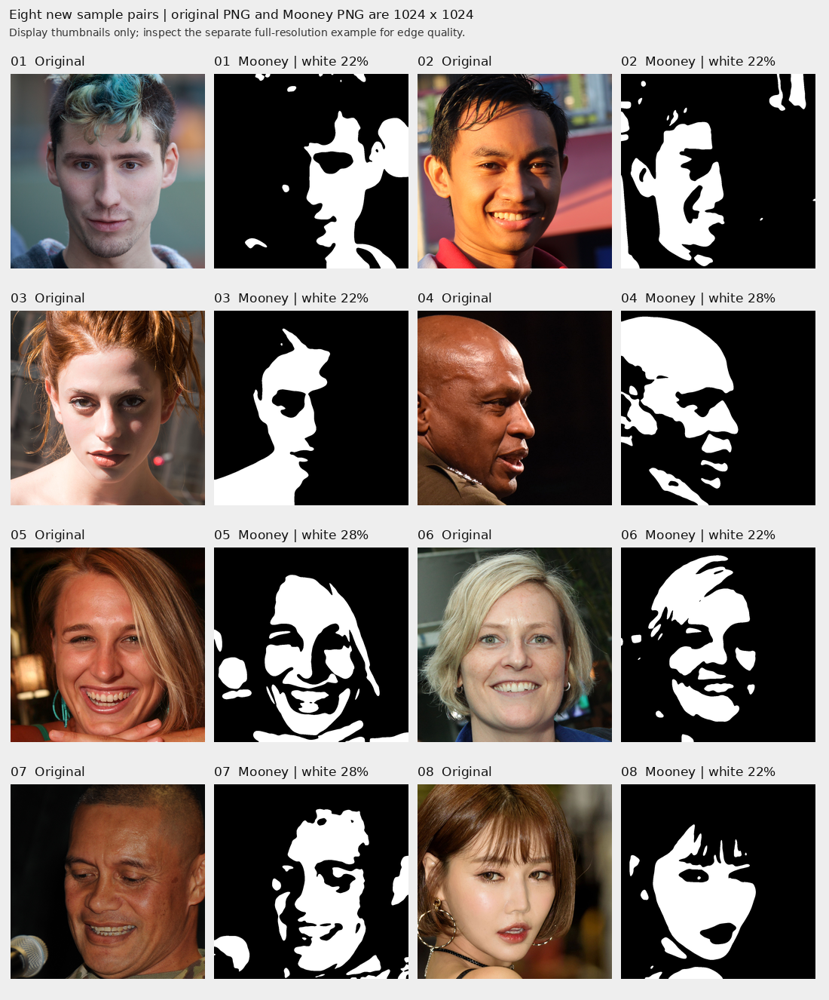

# پیش‌نمایش کیفیت تصاویر Mooney — ۸ جفت تصویر

این پوشه شامل **۸ نمونهٔ آزمایشی** برای بررسی کیفیت است؛ فایل نهایی تحویل پروژه نیست.

- [مشاهدهٔ مقایسهٔ هشت جفت تصویر](eight_sample_pairs.png)
- [مشاهدهٔ نمونه در وضوح اصلی](native_resolution_example.png)
- [دانلود ZIP شامل همهٔ عکس‌های اصلی و Mooney](Mooney_Quality_Preview_8_Pairs.zip?raw=true)

عکس‌های اصلی و خروجی‌های Mooney در ZIP، همگی PNG با ابعاد **۱۰۲۴×۱۰۲۴** هستند. تصاویر جدول صرفاً برای نمایش کوچک شده‌اند. خروجی‌های اصلی فقط شامل پیکسل‌های سیاه و سفید هستند.

## Source and processing

Images come from the FFHQ dataset. Individual photographers, photo URLs and licenses are recorded in [ATTRIBUTION.md](ATTRIBUTION.md), also included in the ZIP. Processing parameters and source hashes are in the ZIP. These previews use new originals and do not reuse the old project's model results.
